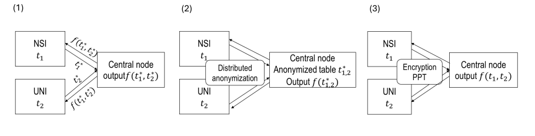

  

## Statistical Disclosure Control
#### Architecture 

{fig-align="center"}
Encryption-based PPT (setup 3)\

Secure Multi Party Computation (sMPC)

## Interactive table

Penguins!
```{r echo=FALSE}
library(DT)

# base R example dataset
data("penguins")

penguins |> datatable(options = list(pageLength = 10), class = "compact")
```

## Moving figure

More penguins.

``` {r echo=FALSE}
library(ggplot2)
library(plotly)

library(plotly)

data("penguins")

# note: i used an LLM to generate the code for this plot. i wanted to create this plot but
# clearly it went beyond what would be required for this class.
# i do understand how plotly can be used for simpler plots though.

d <- na.omit(penguins[, c("body_mass", "flipper_len", "island", "species", "sex")])

# High-contrast palette
my_colors <- c(
  "#0072B2",  # blue
  "#D55E00",  # orange
  "#009E73",  # green
  "#CC79A7",  # purple
  "#E69F00"   # yellow
)

# Function to create traces for a variable
make_traces <- function(data, variable) {
  groups <- unique(data[[variable]])
  
  lapply(seq_along(groups), function(i) {
    g <- groups[i]
    subset <- data[data[[variable]] == g, ]
    
    list(
      x = subset$body_mass,
      y = subset$flipper_len,
      type = "scatter",
      mode = "markers",
      name = g,
      marker = list(
        color = my_colors[i],
        size = 8
      )
    )
  })
}

island_traces  <- make_traces(d, "island")
species_traces <- make_traces(d, "species")
sex_traces     <- make_traces(d, "sex")

# Start with species visible
for (i in seq_along(island_traces))  island_traces[[i]]$visible <- FALSE
for (i in seq_along(species_traces)) species_traces[[i]]$visible <- TRUE
for (i in seq_along(sex_traces))     sex_traces[[i]]$visible <- FALSE

traces <- c(island_traces, species_traces, sex_traces)

fig <- plot_ly()

for (trace in traces) {
  fig <- fig |> add_trace(
    x = trace$x,
    y = trace$y,
    type = trace$type,
    mode = trace$mode,
    name = trace$name,
    marker = trace$marker,
    visible = trace$visible
  )
}

n_island  <- length(island_traces)
n_species <- length(species_traces)
n_sex     <- length(sex_traces)

fig <- fig |>
  layout(
    xaxis = list(title = "Body mass"),
    yaxis = list(title = "Flipper length"),
    updatemenus = list(
      list(
        type = "dropdown",
        active = 1,
        x = 0.01,
        y = 1.15,
        buttons = list(
          list(
            label = "Island",
            method = "update",
            args = list(list(
              visible = c(
                rep(TRUE, n_island),
                rep(FALSE, n_species + n_sex)
              )
            ))
          ),
          list(
            label = "Species",
            method = "update",
            args = list(list(
              visible = c(
                rep(FALSE, n_island),
                rep(TRUE, n_species),
                rep(FALSE, n_sex)
              )
            ))
          ),
          list(
            label = "Sex",
            method = "update",
            args = list(list(
              visible = c(
                rep(FALSE, n_island + n_species),
                rep(TRUE, n_sex)
              )
            ))
          )
        )
      )
    )
  )

fig
```

## A reference
Definition 1. $\epsilon$-Differential Privacy. For $\epsilon > 0$, a mechanism $\mathcal{A}: \mathcal{D} \rightarrow R$ satisfies $\epsilon$-Differential Privacy if, for any two datasets differing in only one unit $D \sim D' \subset \mathcal{D}$ and any set $S \subseteq R$ of possible outputs, the following holds:

$$P[\mathcal{A}(D) \in S] \leq \text{exp}(\epsilon) \cdot P[\mathcal{A}(D') \in S]$$
[@karmitsa2025comprehensive]

## Multirow, aligned equation
For fixed data $Y$, individual $i$, adversary's model $\mathcal{M}$, and released $T^* = t^*$, the relative risk is the posterior-to-prior risk ratio:

$$r_i(p_i, q_i, t^*) = \\ \frac{P[Y_i \in S | I_i = 1, T^* = t^*, \mathcal{M}]}{P(Y_i \in S|I_i = 1, \mathcal{M})} \cdot \frac{P[I_i|T^* = t, \mathcal{M}]}{P[I_i = 1 | \mathcal{M}]}$$
[@kazan2023]

## Multicolumn, R code

:::: {.columns}

::: {.column width="50%"}
Sophisticated R code can be used to write very cool programs. On the right hand side you can
see such a program. 
:::

::: {.column width="50%"}
\

```{r eval=FALSE, echo=TRUE}

print("Hello, World!")
```
:::

:::: 

## Cached and labeled R code
It is executed but not displayed

```{r}
#| echo: false
#| cache: true
#| code-line-numbers: true
#| label: fig-2

ggplot(penguins, aes(bill_len, flipper_len, color = as.factor(year))) +
  geom_point() +
  theme_classic()
```

## `renv` 
### Reproducible ENVironment

```{r echo=TRUE}
library(renv)
init()
snapshot()
```

<div class="small-code">
```{r echo=TRUE}
sessionInfo()
```
</div>


## References
::: {#refs}
:::


